# Client KiwiSDR autonome sur ESP32-S3 (carte ES3C28P)

> **v0.18.1-BETA** : morse plus facile à accrocher.
> - **Accroche CW** : en mode CW, un **appui court** sur le bouton rotatif cale la radio sur la station morse la plus forte à moins de 1 kHz (pic du waterfall affiné entre deux points, au 10 Hz ; il faut au moins 6 dB au-dessus du bruit). La bande du bas affiche « Accroché 7 030,55 kHz · +34 dB sur le bruit » et le décodeur recale sa note. Le pas se change alors en touchant « Pas ».
> - **Toucher le waterfall en CW** accroche le trait le plus proche du doigt (à 12 pixels près), au lieu de régler pile sous le doigt.
> - **Pas d'accélération en CW** : un cran = exactement un pas, même en tournant vite.
> - **Anti-sifflement coupé tout seul en CW** (il effaçait la note du morse), remis en quittant ce mode.
> - Rappel : les petits boutons **−** et **+** au-dessus du waterfall zooment jusqu'à 1,8 kHz de large (environ 6 Hz par pixel).
> - Vérifié dans le simulateur : accroche à 50 Hz près d'une station CW (le décodeur rattrape ±150 Hz), refus à 5 kHz de toute station, toucher à côté du trait.
>
> **v0.18.0-BETA** : contrôle total au bouton rotatif KY-040.
> - **Partout** (menus, listes, Réglages, Décodeurs, Favoris, WiFi, Webradios…) : **tourner** promène un cadre cyan sur les boutons, onglets, lignes et interrupteurs de l'écran, dans l'ordre de lecture ; **appui court** = comme un doigt sur l'élément choisi ; **appui long** = retour (comme la flèche en haut à gauche). Les listes défilent toutes seules pour garder la ligne choisie visible, jusqu'aux boutons du bas.
> - **Curseurs** (volume, bande passante, luminosité, réserve, graves/aigus, seuil de l'AGC, volume webradio, filtre) : un appui entre dans le réglage (cadre orange), tourner change la valeur d'un pas utile par cran (volume 2 %, graves 2 dB, filtre 100 Hz…), un appui valide.
> - **Écran Radio** : rien ne change pour l'accord. L'appui long passe maintenant par Fréquence → Volume → Bande passante → **Boutons** : en mode Boutons, tourner choisit un bouton de l'écran (MENU, AUDIO, mode, pas…), un appui l'active. Après 10 s sans action, le bouton revient sur la fréquence. **Écran Radio FM** : pareil (Fréquence → Volume → Boutons).
> - **Carte du monde** : tourner zoome, l'appui court écoute le récepteur choisi ; l'**appui long revient** maintenant à l'écran précédent (la vue Monde : en dézoomant).
> - Toucher l'écran efface le cadre ; le premier cran le fait revenir. Restent tactiles : faire glisser le waterfall, le pincement, et les appuis longs sur une ligne (supprimer un favori…).
> - Vérifié dans le simulateur (Radio, Menu, Récepteurs avec défilement jusqu'en bas et retour, Réglages avec curseurs, WiFi, Radio FM, Décodeurs) ; le ressenti en main reste à essayer sur la carte.
>
> **v0.17.3-BETA** : la liste des KiwiSDR se charge de façon fiable.
> - **Limites de temps** pendant la réception de la liste (15 s sans rien recevoir, 2 minutes au total, ou la taille annoncée atteinte) : la carte n'attend plus sans fin un site qui garde la connexion ouverte.
> - **Secours** : si rx.linkfanel.net échoue ou ne donne aucun récepteur, la carte passe tout de suite à kiwisdr.com/public.
> - **Copie sur la carte SD** (`/kiwi/liste_kiwisdr.txt`) : chaque liste complète y est enregistrée. Au démarrage, la copie s'affiche tout de suite pendant la mise à jour ; si les deux sites ne répondent pas, la carte s'en sert (« Copie de la carte SD »).
> - **En cas d'échec** : l'écran Récepteurs affiche ce que chaque site a répondu (ex. « rx.linkfanel.net : pas de réponse », « kiwisdr.com : HTTP 503 ») et réessaie seul toutes les 30 s, 3 fois. Les logs donnent les octets reçus, le temps et le nombre de récepteurs.
>
> **v0.17.2-BETA** : liste FM et webradios plus faciles d'accès.
> - **Onglets « Serveurs FM | Webradios »** en haut des deux listes : on passe de l'une à l'autre en un appui, même pendant l'écoute (un point vert montre ce qui joue). Sur l'écran Radio FM, le bouton SERVEURS s'appelle maintenant **LISTES**.
> - **« Chargement » qui ne finissait jamais** : la liste FM a maintenant des limites de temps (15 s sans rien recevoir, 90 s au total, ou la taille annoncée atteinte). Ce qui est reçu est gardé ; si le site a été coupé, la carte note « liste incomplète ». Les logs disent combien d'octets ont été reçus et en combien de temps.
>
> **v0.17.1-BETA** : corrige le chargement de la liste des serveurs FM.
> - **Plus de mémoire pour les connexions chiffrées** (HTTPS) : les tâches FT8 et webradio ne sont plus créées au démarrage mais au premier usage, et leur pile est placée en PSRAM. La mémoire interne retrouve ainsi environ 32 Ko, ce dont le téléchargement de la liste FM (servers.fmdx.org, en HTTPS) a besoin.
> - **Un téléchargement bloqué ne bloque plus les autres** : la liste FM attendait sans fin si celle des récepteurs VHF/UHF, la position ou l'état d'un récepteur restait coincé ; au-delà d'une minute, elle part quand même. Elle n'est plus lancée en même temps que la liste des KiwiSDR (deux connexions chiffrées à la fois manquaient de mémoire).
> - **En cas d'échec** : l'écran « Serveurs FM » affiche la raison exacte (ex. « connexion chiffrée impossible, mémoire 31 Ko », « le site répond HTTP 503 ») et la carte réessaie seule toutes les 20 s, 3 fois. Les logs série donnent la mémoire libre au moment du téléchargement.
>
> **v0.17.0-BETA** : webradios et décodeur FT8.
> - **Webradios** : Menu › Radio FM › **Webradios**. L'annuaire libre radio-browser.info (environ 50 000 stations) : choix rapides sur l'écran (Favoris, France, Info, Musique, Jazz, Classique), recherche par nom, pays et genre sur la page web (onglet FM). Flux **MP3** (minimp3) et **AAC / HE-AAC** (décodeur Helix), en HTTP ou HTTPS, y compris les vieux serveurs Shoutcast (« ICY 200 ») et les listes .m3u / .pls. Le **titre du morceau** s'affiche (métadonnées ICY ; les accents Latin-1 sont corrigés). **Favoris** (16, étoile sur chaque ligne). Volume, graves/aigus et limiteur marchent comme pour la radio ; la réserve passe à 1,5 s pendant une webradio (rien ne presse) et revient ensuite. Si l'annuaire se trompe de format, la carte essaie l'autre. Écouter un récepteur ou la FM arrête la webradio. Pas lu : les flux HLS (.m3u8) et Ogg/Opus. Mesuré sur PC : MP3 128 kb/s et AAC 128 kb/s décodés sans perte de trame, découpés au hasard, titres ICY tous lus.
> - **Décodeur FT8** (réception) : Décodeurs › **FT8**. Le bouton « Bande » va sur les fréquences FT8 (160 m à 6 m, USB, filtre élargi à 3 kHz). Toutes les 15 secondes (heure Internet), la carte décode la période écoulée dans une tâche à part : liste des messages avec S/B, fréquence, **pays** de l'indicatif et **distance** au récepteur (d'après le locator). Les appels généraux (CQ) sont en vert. **Carte** : les stations entendues sur la carte du monde (30 dernières minutes) ; en toucher une donne son pays, son locator, son S/B et sa distance. **Sauver SD** écrit le journal dans `/kiwi/ft8_….txt`. Aussi sur la page web (onglet Décodeurs). Bibliothèque **ft8_lib** (Kārlis Goba, licence MIT). Mesuré sur 27 enregistrements réels (ceux de ft8_lib, comparés à WSJT-X) : **74 % des messages de WSJT-X** trouvés, **0 faux décodage** sur 20 périodes de bruit, S/B juste à 6 dB près dans 84 % des cas, 22 ms par période sur PC ; sur l'ESP32-S3, le temps s'affiche à l'écran (« 3 msg · 1,4 s »), à vérifier sur la carte (il doit rester sous 15 s).
> - Vérifié sur les bancs d'essai, dans le simulateur (écrans, FT8 de bout en bout sur 3 périodes réelles, webradio avec flux simulé), sur la page web (Playwright) et par compilation ; pas encore sur la carte.
>
> **v0.16.0-BETA** : réception optimisée. Chaque point a été mesuré sur un banc d'essai (dossier `outils/banc_reception`).
> - **Moins de coupures du son** : quand Internet prend du retard, le son descend en 5 ms au lieu de s'arrêter net (plus de clic), et remonte de même. La réserve **s'agrandit d'elle-même** si deux coupures arrivent à moins d'une minute (jusqu'à +1 s), puis redescend après 3 minutes calmes. Mesuré sur 10 minutes de réseau irrégulier : 29 à 35 coupures → 8 à 10 ; avec des blocages du WiFi : 49 à 59 → 14 à 21 ; clics : 30 à 61 → **0**. Ce qui est ajouté s'affiche dans la réserve son.
> - **AM synchrone sur une seule bande** (KiwiSDR) : Réglages › AM synchrone : Arrêt, 2 bandes, Haute, Basse. Avec une station voisine collée d'un côté, on écoute l'autre côté. Mesuré : voisin de même force à 5 kHz, rapport signal/brouillage **9 dB → 20 dB** ; à 6 kHz, 14 → 21 dB. Sans brouilleur, une bande perd 3 dB : garder « 2 bandes » dans ce cas. Témoins SYNC+ (haute) et SYNC− (basse).
> - **AGC réglable** (KiwiSDR) : nouveau curseur dans le panneau AUDIO. Avec l'AGC : son seuil (−130 à −60 dB ; plus bas = les signaux faibles sont remontés plus fort, le bruit aussi). Sans AGC : le gain fixe (0 à 120 dB), utile en CW ou avec un fading rapide.
> - **Anti-parasites réglable** (KiwiSDR) : le bouton passe Arrêt → Faible → Moyen → Fort (seuil 70, 50, 30 ; porte de 100 µs, 200 µs en Fort). Le réglage « en marche » des versions précédentes correspond à Moyen ; il revient à Faible après la mise à jour.
> - **Réduction de bruit sur la carte pour OpenWebRX**, qui n'en a pas : spectre glissant de 256 points, bruit appris en continu, gain de Wiener « dirigé par la décision » (peu de bruit musical), jamais de silence total. Elle reprend le choix Douce / Forte du panneau AUDIO (sauf en FM large). Mesuré sur de la parole synthétique : rapport signal/bruit amélioré de **7 dB (Douce)** et **9 à 10 dB (Forte)** à 0–5 dB d'entrée, 6 à 7 dB à 20 dB d'entrée ; la parole perd 1 à 5 dB. Retard ajouté : 21 ms.
> - **Rapport signal/bruit (S/B)** affiché à côté des dBm (vert ≥ 20 dB, jaune ≥ 8 dB, orange en dessous), aussi sur la page web. C'est le plus fort du filtre d'écoute comparé au bruit de fond du waterfall ; zoomé très serré, la carte garde le bruit vu juste avant. Précision mesurée dans le simulateur : environ ±4 dB.
> - **Meilleur récepteur en VHF/UHF** : le bouton « Meilleur récepteur » compare maintenant aussi les récepteurs OpenWebRX les plus proches qui annoncent la bande ; chacun est réglé sur la bonne bande puis sur la fréquence, mesuré 3 s, et la carte reste sur le meilleur. Attention : sur OpenWebRX, un autre auditeur peut changer la bande du récepteur.
> - **Meilleur serveur FM** : bouton « Meilleur » sur l'écran Radio FM. La carte essaie les serveurs FM-DX libres les plus proches, **sans jamais changer la fréquence d'un tuner que quelqu'un d'autre écoute** (« occupé »), mesure le signal (dBf) et le code PI : un serveur qui reçoit un autre émetteur que celui de départ passe après les autres.
> - AGC (seuil, gain fixe) dans la sauvegarde des réglages. Commandes web : `nb 0..3`, `sam 0..3`, `agcseuil`, `gainman`.
> - Vérifié sur les bancs d'essai, dans le simulateur (commandes envoyées au KiwiSDR, écrans), sur la page web (Playwright) et par compilation ; pas encore sur la carte. Les réglages de l'anti-parasites et du mode SAU/SAL suivent l'interface web du KiwiSDR : à confirmer sur un vrai récepteur.
>
> **v0.15.2-BETA** : le décodeur morse (CW) refait.
> - **Accord CW corrigé** : la fréquence affichée est maintenant celle de la station, et on l'entend à 500 Hz. Avant, la station se trouvait 0,5 kHz au-dessus de la fréquence affichée : toucher une trace morse dans le waterfall, ou taper la fréquence d'une station, la mettait hors du filtre CW (rien à entendre ni à décoder). Les favoris et mémoires de bandes CW déjà enregistrés sont remontés une fois de 0,5 kHz pour rester sur la même station. Sur OpenWebRX, le filtre CW est maintenant centré sur la station.
> - **Note juste dès l'ouverture** : le décodeur part de 500 Hz (la note du KiwiSDR) et ne se cale qu'après 1,3 seconde de son mesuré. Avant, il se calait sur un spectre vide et prenait 700 Hz.
> - **Nouveau détecteur** : filtre étroit dont la largeur suit la vitesse (beaucoup moins de bruit), note suivie automatiquement à ±150 Hz, niveaux du bruit et du signal appris chacun de leur côté, anti-rebond, vitesse calculée sans biais (elle ne dépend plus de la longueur des traits de l'opérateur), et silence quand il n'y a pas de vrai signal morse. Sur un banc d'essai de morse synthétique : lisible sans erreur jusqu'à un rapport signal/bruit de 5 dB (avant : 70 % d'erreurs à 5 dB), fading de 10 dB sans erreur (avant 20 à 40 %), plus de texte inventé sur du bruit seul (avant : 47 lettres en 20 s), vitesses de 5 à 45 mots/min. Les premières lettres d'une émission peuvent encore être perdues, le temps d'apprendre la vitesse.
> - **Texte morse sur l'écran Radio** : en mode CW, une ligne en bas du waterfall affiche le texte décodé et la vitesse (point vert : signal accroché). La toucher ouvre l'écran Décodeurs. Réglages > « Texte morse (Radio) » pour l'enlever.
> - Vérifié sur le banc d'essai, dans le simulateur et par compilation ; pas encore sur la carte ni sur de vrais signaux.
>
> **v0.15.1-BETA** : la carte du monde devient pratique.
> - **Zoom progressif** : 7 niveaux, du monde entier à ×64 (une région). Le **bouton rotatif KY-040** zoome d'un niveau par cran ; sans lui, les boutons **+** et **−** de l'écran font la même chose. Le niveau est affiché en haut (« ×8 »).
> - **Déplacement au doigt** : on fait glisser la carte dans tous les sens.
> - **Choix d'un récepteur** : un toucher bref prend le récepteur le plus proche du doigt (20 pixels autour, les récepteurs libres d'abord) ; un anneau qui respire le signale. S'il n'y a aucun récepteur sous le doigt, la vue zoome d'un niveau à cet endroit.
> - **Le zoom va où il faut** : à la première ouverture il part de ta position ; quand un récepteur est choisi, il se fait autour de lui. En vue Monde, un cadre montre ce que le prochain cran affichera.
> - **Noms sur la carte** dès qu'il reste 14 récepteurs ou moins à l'écran ; les points grossissent avec le zoom.
> - **Bouton rotatif** sur la carte : tourner = zoom, appui court = écouter le récepteur choisi, appui long = vue Monde. Il reprend son rôle habituel en quittant la carte.
> - **Fond deux fois plus fin** (un point tous les 0,25°, 130 Ko dans le programme) pour que les côtes restent lisibles aux forts zooms.
> - Vérifié dans le simulateur et par compilation ; pas encore sur la carte.
>
> **v0.15.0-BETA** : choisir le bon récepteur.
> - **Meilleur récepteur pour une fréquence** (ondes courtes, KiwiSDR) : Récepteurs > KiwiSDR, en bas à gauche, ou le bouton de la page web (onglet Radio). La carte mesure le récepteur écouté, puis se connecte tour à tour à 4 KiwiSDR libres, placés à 250 km au moins les uns des autres ; sur chacun, elle relève pendant 3 secondes de combien le signal dépasse le bruit à l'endroit du filtre, et elle reste sur le meilleur. Compter 30 secondes ; le son passe d'un récepteur à l'autre pendant la recherche. Les candidats sont pris autour de l'émetteur quand la station est dans l'annuaire avec sa position, sinon autour du récepteur écouté. Toucher le panneau arrête la recherche.
> - **Carte du monde** (Récepteurs, en bas à droite) : les KiwiSDR (verts ; gris quand ils sont pleins) ou les récepteurs VHF/UHF (bleus) sur une carte, avec la zone de nuit à l'heure qu'il est et la position du soleil. Vue Monde : toucher une région zoome 4 fois. Vue zoomée : toucher un récepteur affiche son nom, sa distance, ses auditeurs et s'il y fait jour ou nuit, avec un bouton Écouter ; toucher ailleurs déplace la vue. La croix, c'est ta position ; l'anneau, le récepteur écouté.
> - La carte terre / mer (un point tous les 0,5°, 32 Ko) est fabriquée par `outils/carte/faire_carte.py` à partir de données du domaine public.
> - Vérifié dans le simulateur et par compilation ; pas encore sur la carte. La mesure compare des récepteurs dont les antennes et le bruit local diffèrent : c'est bien le rapport signal sur bruit qui est comparé, mais sur 3 secondes seulement, donc un signal qui s'évanouit au mauvais moment peut fausser le classement.
>
> **v0.14.0-BETA** : une bande à la place de la roue, confort d'écoute, traces d'écoute.
> - **Bouton rotatif KY-040 : une bande fine au lieu de la grande roue.** La roue cachait le centre du waterfall, là où on règle. Elle est supprimée, y compris la roue tactile de l'autoscan. À la place, une bande de 17 pixels en bas du waterfall : un trait part du milieu vers le + ou vers le −, d'autant plus loin qu'on tourne vite, avec le saut écrit à côté (« +1 kHz · lent »). Pour le volume et la bande passante, une jauge avec la valeur. Elle s'efface 1,2 seconde après le dernier cran.
> - **Autoscan au bouton** : pendant un scan, tourner dans le sens du scan l'accélère, tourner dans l'autre sens le ralentit puis le fait repartir dans l'autre sens. Toucher l'écran arrête le scan, comme avant.
> - **Mémoire par bande** : la carte retient, pour chaque bande, la dernière fréquence écoutée au moins 3 secondes et son mode. Les raccourcis de bandes du clavier (ils affichent cette fréquence) et les bandes de « Quoi écouter » y reviennent.
> - **Décalage du filtre** : dans le panneau de bande passante (toucher « BP … » sous la fréquence), un second curseur déplace le filtre d'un côté sans changer la fréquence, pour écarter un brouilleur voisin : ±1 kHz en BLU, ±3 kHz en AM, ±400 Hz en CW, par crans de 50 Hz. « Origine » le recentre. Il n'est pas gardé au redémarrage.
> - **Tonalité** (Réglages : Graves, Aigus, de −8 à +8 dB) : utile avec le petit haut-parleur.
> - **Mode nuit** (Réglages : Arrêt, 1, 5 ou 15 minutes) : sans toucher pendant ce temps sur l'écran Radio ou Radio FM, l'écran s'atténue et affiche l'heure et la fréquence en grand. Un toucher ou un cran du bouton le réveille, sans rien régler.
> - **Journal d'écoute** : toute fréquence écoutée au moins 30 secondes est notée (heure, fréquence, mode, durée, signal le plus fort, récepteur, station si elle est dans l'annuaire). Les 60 dernières sont sur la page web (onglet Favoris), avec téléchargement en CSV ; avec une carte SD, tout l'historique est dans `/kiwi/journal.csv`.
> - **Sauvegarde et restauration** (page web, onglet Système) : un fichier avec les réglages, les favoris, les récepteurs personnels, la position et les mémoires de bandes. Le WiFi et son mot de passe n'y sont pas. Restaurer remplace les réglages puis redémarre la carte.
> - **Graphique du signal** : toucher le S-mètre affiche le signal des 2 dernières minutes (minimum, maximum, écart) ; on voit le fading et si la station monte ou descend. Retoucher le ferme.
> - Vérifié dans le simulateur et par compilation ; pas encore sur la carte (bouton rotatif, restauration et journal sur carte SD compris).
>
> **v0.13.1-BETA** : version corrective, après des redémarrages signalés avec la v0.13.0 (cause pas encore prouvée).
> - **Lecture de la propagation (NOAA) sécurisée** : c'est la seule tâche nouvelle qui se lance toute seule. Elle a deux fois plus de mémoire de travail, ne part plus que 90 secondes après le démarrage, et si la carte redémarre pendant la lecture, la lecture est coupée au démarrage suivant au lieu de recommencer en boucle. Page web, onglet Réglages : bouton « Propagation du jour (NOAA) » pour la couper ou la remettre, avec son état.
> - **Moniteur série plus parlant** : chaque ligne commence par le temps écoulé depuis le démarrage ; la ligne `[KIWI] Demarrage : …` dit pourquoi la carte a démarré (mise sous tension, plantage du programme, chien de garde, alimentation trop faible…) ; `[KIWI] REPRISE apres=…` dit pourquoi la reprise automatique reconnecte. La raison du dernier démarrage est aussi dans l'onglet Système de la page web.
>
> **v0.13.0-BETA** : mise à jour par la page web, squelch, scan des favoris, enregistrement à la voix, AM synchrone, redirection et reprise automatiques, propagation du jour.
> - **Mise à jour par la page web** (onglet Système) : on choisit `binaires/kiwi_console.ino.bin`, on clique Envoyer, la carte redémarre sur la nouvelle version. Plus besoin de câble ni d'Arduino une fois cette version installée (elle, il faut encore l'installer par le câble). La carte garde deux emplacements de programme : si l'envoi échoue, l'ancienne version reste. Les fichiers « merged » et « bootloader » sont refusés. Réglages, favoris et WiFi sont conservés.
> - **Squelch** (Réglages : Arrêt, Bas, Moyen, Haut) : le haut-parleur se tait quand rien ne dépasse le bruit à l'endroit du filtre, et se rouvre dès qu'un signal arrive ; il reste ouvert 2 secondes pendant les pauses. Témoin **SQ** en haut de l'écran Radio : vert = ouvert, ambre = le squelch coupe le son. Il lit le waterfall : avec une vitesse de waterfall de 1, il s'ouvre avec une à deux secondes de retard (vitesse 3 ou 4 conseillée en VHF). Sans waterfall, il laisse passer le son.
> - **Scan des favoris** (bouton Scanner de l'écran Favoris, et sur la page web) : la carte passe en revue les favoris que le récepteur en cours peut capter, en silence, et s'arrête sur celui où il y a un signal : elle l'écoute tant qu'il dure, 10 secondes au plus, puis continue. Toucher l'écran arrête le scan sur le favori en cours. La sensibilité est celle du scan (Réglages).
> - **Enregistrer à la voix** (Réglages) : l'enregistrement WAV ne garde que les passages où il y a un signal. Un journal `rec_….txt` est écrit à côté : une ligne par passage, avec l'heure, la fréquence et la durée. Fonctionne aussi squelch arrêté.
> - **AM synchrone** (Réglages, KiwiSDR seulement) : l'AM est démodulée en synchrone par le récepteur, ce qui réduit la distorsion quand une station d'ondes courtes s'évanouit. Témoin **SYNC**.
> - **Redirection automatique** dans « Quoi écouter » : toucher une ligne que le récepteur en cours ne capte pas (« autre récepteur ») connecte la carte au récepteur adapté le plus proche (KiwiSDR pour les ondes courtes, récepteur VHF/UHF sinon), puis règle la fréquence. Un récepteur VHF/UHF n'annonce ses bandes qu'une fois connecté : s'il ne capte pas la bande voulue, la carte essaie le suivant (4 essais au plus). Marche aussi sans récepteur connecté.
> - **Reprise automatique** (Réglages, activée d'origine) : si la connexion tombe pendant l'écoute, la carte se reconnecte (2 essais), puis passe sur le KiwiSDR libre le plus proche, sur la même fréquence. Rien ne se passe si c'est toi qui déconnectes ou qui choisis un autre récepteur.
> - **Propagation du jour** : la carte lit toutes les 3 heures le flux solaire et l'indice Kp publiés par la NOAA. Un flux élevé remonte les bandes hautes dans « Quoi écouter », un Kp de 5 ou plus (orage magnétique) abaisse toutes les ondes courtes. Les deux valeurs s'affichent en tête de la liste. La NOAA a changé le format de ces fichiers en 2026 : l'ancien et le nouveau sont compris, mais la lecture n'a pas pu être essayée sur le vrai site (ligne `[KIWI] Propagation : …` sur le moniteur série). Sans ces valeurs, rien ne change.
> - Corrigé : dans une liste déroulée (Réglages surtout), une ligne à moitié cachée sous l'en-tête pouvait prendre les touchers du bouton Retour.
> - Vérifié dans le simulateur et par compilation ; pas encore sur la carte. La mise à jour par la page web ne peut pas être essayée sans la carte.
>
> **v0.12.0-BETA** : **« Quoi écouter »**, le menu qui propose où il y a le plus à écouter maintenant.
> - **Menu > Quoi écouter** (à la place de la tuile Fréquence) : une liste classée, avec quatre catégories : Ondes courtes, VHF, UHF, Tout. Toucher une ligne règle la radio dessus (fréquence, mode, pas ; sur un récepteur OpenWebRX, la bande change toute seule).
> - **Estimation** (immédiate, rien n'est capté) : elle part de l'heure, de la saison et de la position **du récepteur écouté** (hauteur du soleil chez lui). Les bandes basses portent loin la nuit, les bandes hautes le jour ; en VHF/UHF, ce sont les habitudes (aviation le jour, radioamateurs le soir) et les aérodromes les plus proches du récepteur (ATIS, tour, approche).
> - **Bouton Mesurer** : l'activité réelle. Sur un KiwiSDR, le waterfall visite chaque bande et compte les signaux qui dépassent le bruit (10 à 20 secondes, **le son continue**) ; la liste est reclassée et toucher une bande va sur son signal le plus fort. Sur un récepteur OpenWebRX, seule la bande en cours est mesurée (changer de bande dérangerait les autres auditeurs). Une mesure reste affichée 15 minutes.
> - **Bouton Fréquence** en haut à droite de cet écran : le clavier de saisie, inchangé. Toucher la grande fréquence de l'écran Radio l'ouvre toujours.
> - Ce que le récepteur ne capte pas est grisé (« indisponible ») ; un bandeau en bas mène à la bonne liste de récepteurs. « Radio FM » sans bande FM ouvre la radio FM par Internet.
> - Raccourci « Quoi écouter maintenant » en bas de **Récepteurs > Proches** ; nouvel onglet **Quoi écouter** sur la page web (mêmes suggestions, même mesure).
> - Vérifié dans le simulateur et par compilation ; pas encore sur la carte. Les niveaux estimés sont des règles générales de propagation, pas une prévision du jour : c'est la mesure qui tranche.
>
> **v0.11.2-BETA** : bandes passantes d'origine.
> - Bouton **Origine** dans le panneau de bande passante (toucher « BP … ») : un appui remet la valeur d'origine du mode en cours ; un **appui long** remet tous les modes. Sur la page web (onglet Radio) : « Origine (ce mode) » et « Origine (tous les modes) ».
> - Valeurs d'origine : AM 9 kHz, LSB et USB 2,4 kHz, CW 400 Hz, FM 12 kHz, WFM 150 kHz.
> - **AM en VHF** : au-dessus de 30 MHz (aviation), l'AM a sa propre bande passante, 6 kHz d'origine. La carte passe de l'une à l'autre toute seule et retient les deux.
>
> **v0.11.1-BETA** : **bande passante réglable sur l'écran Radio**, en écoutant.
> - **Deux doigts sur le waterfall** : les écarter élargit le filtre, les rapprocher le resserre. La valeur s'affiche en grand et la zone du filtre est surlignée. La fréquence ne bouge pas pendant le geste.
> - **Toucher « BP … »** sous la fréquence : un panneau avec un curseur et trois valeurs rapides selon le mode (AM 4/6/9 kHz, BLU 1,8/2,4/2,8 kHz, CW 100/250/500 Hz, FM 8/12/16 kHz). Il se referme tout seul après 5 s.
> - **KY-040** : l'appui long passe de Fréquence à Volume, puis à Bande passante (un cran = un pas du filtre).
> - Pas du réglage : 100 Hz en BLU, 500 Hz en AM et FM, 50 Hz en CW. La valeur reste mémorisée par mode.
> - **Menu > WiFi**, ligne « Écran tactile » : indique si la dalle a vu deux doigts (certaines dalles n'en remontent qu'un ; dans ce cas, utiliser le panneau ou le KY-040).
>
> **v0.11.0-BETA** : **position de la carte** et écran **« Près de moi »**.
> - **Position automatique** : au démarrage, la carte demande sa position d'après son adresse Internet (service gratuit ip-api.com, usage non commercial). La précision est celle de la ville, parfois 20 à 50 km à côté ; elle est fausse avec un VPN ou une box 4G.
> - **Position choisie** : sur la page web (Réglages > Ma position), tape le nom d'une ville (recherche par open-meteo.com) ou saisis la latitude et la longitude. Un choix à la main reste prioritaire : la carte ne le remplace plus par la position automatique. Si une position autre que Paris était déjà réglée, elle est gardée.
> - **Récepteurs > Proches** (page web : Récepteurs > Près de moi) : les 5 KiwiSDR les plus proches avec une place libre, les 5 récepteurs VHF/UHF et les 5 serveurs FM les plus proches, avec la distance. Un appui s'y connecte. Le bouton **Localiser** relance la recherche de la position.
> - **Favoris** : la distance du récepteur est affichée quand il figure dans les listes.
> - Les distances des trois listes (KiwiSDR, VHF/UHF, FM) sont recalculées dès que la position change.
>
> **v0.10.3-BETA** : corrections, et canaux VHF plus clairs.
> - **Autoscan FM** : après un arrêt pendant la montée sur une station forte, le scan suivant sautait les stations moins fortes. Corrigé.
> - **Favoris OpenWebRX** : l'adresse (chemin) et le nom ne sont plus tronqués. Les favoris existants sont repris.
> - **Aérodromes** : seuls ceux à moins de 200 km du récepteur sont gardés en mémoire (quelques dizaines de Ko au lieu de près de 3 Mo avec la liste mondiale de la carte SD).
> - **KY-040** : en mode volume (appui long), le bouton règle aussi le volume sur l'écran Radio FM.
> - **Canaux VHF** : la liste n'affiche plus de lignes mélangées quand elle est refaite.
> - **Autoscan sur KiwiSDR** : les étiquettes de stations ne sont plus demandées au récepteur pendant la recherche.
> - **Bandes exactes** : à la connexion, la carte lit le `status.json` du récepteur OpenWebRX, qui donne la plage de chaque bande. Le changement de bande automatique ne dépend plus du nom des bandes (sinon, estimation d'après le nom, comme avant).
> - **Canaux VHF, points de couleur** : vert = dans la bande en cours ; bleu = dans une autre bande du récepteur (la carte change de bande toute seule) ; gris = ce récepteur ne le capte pas.
> - **Filtre « Ici »** (coché par défaut ; sur la page web : « Seulement les canaux que ce récepteur capte ») : la liste ne montre que les canaux écoutables sur ce récepteur.
> - Messages plus clairs : « Ce récepteur ne capte pas la marine : essaie un autre récepteur ».
>
> **v0.10.2-BETA** : **autoscan FM** (serveurs FM-DX).
> - Boutons **◀◀ et ▶▶** sur l'écran Radio FM et sur la page web (onglet FM). Le scan avance de 0,1 MHz en 0,1 MHz, avec l'affichage et le son. Il attend que le serveur confirme chaque fréquence et mesure le signal. Si la fréquence suivante est plus forte, il monte jusqu'au sommet de la station.
> - Une station est retenue si son signal dépasse nettement le bruit (sensibilité Faible / Moyen / Fort, la même que pour le scan SDR). Elle est écoutée 5 s, puis le scan repart. Arrivé à 108 MHz, il repart de 87,5 MHz.
> - Comme pour le scan SDR : re-appuyer sur le même bouton accélère (vitesses 1 à 4), le 5e appui arrête ; toucher l'écran ou tourner le KY-040 arrête aussi.
> - **Stations trouvées** : fréquence, nom RDS et niveau sont notés au passage. Le bouton « Trouvées » de l'écran FM (et la liste de l'onglet FM de la page web) permet de les rappeler d'un appui. La liste est effacée quand on change de serveur.
> - Le tuner d'un serveur FM-DX est partagé : les autres auditeurs entendent aussi le scan. Si le serveur refuse le changement de fréquence, le scan s'arrête avec un message.
>
> **v0.10.1-BETA** : molette et bouton rotatif.
> - **Défilement de l'autoscan** : en cherchant, le scan passe réellement par les fréquences intermédiaires (5 kHz en ondes courtes, 12,5 kHz en VHF), avec l'affichage et le son, comme un vieux scanner. La vitesse 1 à 4 règle la rapidité du défilement.
> - **Molette à l'écran** (120 pixels, sur le waterfall) : pendant un autoscan, pose le doigt sur le waterfall. Le scan s'arrête, la molette apparaît, et en tournant du doigt la fréquence monte (sens des aiguilles d'une montre) ou descend. Plus tu tournes vite, plus les sauts sont grands. Elle disparaît quand tu lèves le doigt. Toute la zone du waterfall réagit.
> - **Bouton rotatif KY-040** (facultatif), sur le connecteur d'extension : **CLK → IO2, DT → IO14, SW → IO21, + → 3,3 V, GND → GND** (jamais 5 V).
>   - Tourner : la fréquence change d'un pas par cran, plus vite si tu tournes vite. La molette s'affiche et tourne avec le bouton.
>   - Appui court : pas suivant. Appui long : le bouton règle le volume (un autre appui long revient à la fréquence).
>   - Sur l'écran Radio FM : 0,1 MHz par cran. Pendant un autoscan, tourner l'arrête.
>   - Réglages > « Bouton rotatif » : Arrêt, Normal ou Inversé (si le sens est à l'envers).
>
> **v0.10.0-BETA** : **canaux VHF** (aviation, marine, radioamateurs, PMR446), pour les récepteurs OpenWebRX.
> - **La liste** : les fréquences communes (121,500 détresse, 123,450 air-air, canaux marine 16, 6, 8, 9, 10, 12, 13, 14, 67, 68, 69, 72, 77, appels 2 m et 70 cm, ISS, les 16 canaux PMR446) et les **aérodromes à moins de 200 km du récepteur** (tour, approche, sol, ATIS…), du plus proche au plus lointain. La position du récepteur vient d'OpenWebRX, sinon de la liste ReceiverBook, sinon de ta position.
> - **Aérodromes** : ceux d'Europe sont intégrés au firmware (OurAirports, domaine public). Pour le monde entier, copie `carte_sd/kiwi/aero.txt` du projet dans le dossier `kiwi` de la carte SD : il est utilisé au démarrage à la place de la liste intégrée. Pour mettre la liste à jour : `outils/aero/faire_aero.py`.
> - **À l'écran** : touche la fréquence, puis **Canaux VHF ›**. On y trouve des filtres (Tous, Aviation, Marine, Radioam., PMR) et la liste. Un point vert indique un canal dans la bande en cours.
> - **Choix automatique de la bande** : toucher un canal règle la fréquence, le mode et le pas. Si le canal sort de la bande en cours, la carte choisit une bande du récepteur qui le couvre (d'après les bandes déjà visitées, sinon d'après leur nom : « Air », « Marine », « 118-137 MHz »…).
> - **Scanner** (écran Canaux VHF ou page web) : la carte passe en revue les canaux de la liste qui sont dans la bande en cours, s'arrête sur celui qui parle, reste tant qu'il parle (plus 3 s), puis repart. Toucher l'écran l'arrête.
> - **Page web** : onglet Stations, bouton **Canaux VHF/UHF** (recherche, filtres, scan).
> - Écouter l'aviation et la marine est toléré, mais on ne doit ni enregistrer ni divulguer ce qu'on entend.
>
> **v0.9.2-BETA** :
> - **Vitesse de l'autoscan** : pendant un scan, chaque nouvel appui sur le même bouton (◀◀ ou ▶▶) accélère, de la vitesse 1 à la vitesse 4. Le 5e appui arrête le scan, comme un doigt ailleurs sur l'écran. Un nouveau scan repart en vitesse 1.
>   - Sur KiwiSDR, la vue s'élargit d'un cran par vitesse (chaque saut couvre plus de fréquences) et l'attente entre deux sauts raccourcit. Une station trouvée est recalée au zoom habituel pour viser juste.
>   - Sur OpenWebRX, le scan cherche dans toute la bande d'un coup.
>   - En FM (VHF/UHF), le scan se cale sur des canaux de 12,5 kHz.
> - Le « … ms » (réserve de son) quitte le haut de l'écran : il est dans **Menu > WiFi**, avec le nombre de coupures. Le nom du récepteur prend la place libérée.
> - Sur OpenWebRX, les pastilles NR, NB et AGC ne s'affichent plus (sans effet sur ces récepteurs).
>
> **v0.9.1-BETA** : corrige les « Connexion perdue » sur les récepteurs OpenWebRX en https. Chaque commande envoyée (fréquence, mode, scan) part maintenant d'un seul bloc. Avant, l'en-tête et le contenu partaient dans deux paquets chiffrés séparés : OpenWebRX lisait l'en-tête sans le contenu et fermait la connexion.
>
> **v0.9.0-BETA** : récepteurs **VHF / UHF** (au-dessus de 30 MHz) avec **OpenWebRX**.
> - **Récepteurs** : en haut, choisis **KiwiSDR** (ondes courtes) ou **VHF/UHF**. La liste VHF/UHF vient de receiverbook.de (récepteurs OpenWebRX qui couvrent la VHF ou l'UHF), triée par distance, et elle est gardée sur la carte SD (`/kiwi/vhf.txt`). La flèche en haut à droite la recharge.
> - **Bandes** : un récepteur OpenWebRX ne voit que quelques MHz à la fois. Ses bandes (2 m, 70 cm, aviation…) s'affichent dans **Menu > Fréquence** (toucher la fréquence) et sur la page web, onglet Radio. Changer de bande la change aussi pour les autres auditeurs de ce récepteur.
> - **Fréquence en MHz** au-dessus de 30 MHz ; saisie au pavé en MHz.
> - **Modes** : AM, LSB, USB, CW, FM (NFM) et **WFM** (FM large, son 48 kHz) ; pas de 12,5 kHz, 25 kHz et 100 kHz.
> - **Autoscan** dans la bande choisie, calé sur les canaux habituels (12,5 kHz en FM, 8,33 kHz en aviation, 50 kHz en FM large).
> - **Favoris** : ils retiennent aussi les récepteurs OpenWebRX.
> - Page web : onglet Récepteurs, choix KiwiSDR / VHF-UHF, recherche, et « Écouter une adresse OpenWebRX ».
> - Les réglages des versions précédentes sont repris.
>
> **v0.8.0-BETA** : **autoscan** sur l'écran Radio. Les boutons ◀◀ et ▶▶, à côté du zoom, cherchent la prochaine station audible vers le bas ou vers le haut. La recherche se fait dans le waterfall : le prochain pic qui sort du bruit. Quand une station est trouvée, le scan s'y arrête, on l'écoute 5 s, puis il repart tout seul dans le même sens. Un doigt n'importe où sur l'écran arrête le scan et on reste sur la station. Arrivé en bout de bande, le scan repart de l'autre extrémité. La **sensibilité** (Faible, Moyen ou Fort) se règle dans Réglages et sur la page web, et elle est enregistrée. Les mêmes commandes sont sur la page web, onglet Radio. Sur un canal sans waterfall, le scan avance pas à pas en lisant le S-mètre (plus lent). Plus le zoom est large, plus le scan va vite.
>
> **v0.7.9-BETA** : les noms trop longs **défilent** comme sur un autoradio, au lieu d'être coupés par « … ». C'est le cas du nom du récepteur en haut de l'écran, du nom du serveur FM et du texte RDS. Le texte marque une pause de 2 s sur son début, défile à environ 30 pixels par seconde, puis repart en boucle, avec un fondu sur les bords. Un nom qui tient dans la place reste fixe.
>
> **v0.7.8-BETA** : connexions plus robustes. Les **redirections HTTP** (301/302/307/308, par exemple du relais proxy.kiwisdr.com vers https) sont suivies ; délai de connexion porté à 10 s ; **3 essais** puis « Récepteur injoignable (hors ligne ?) » ; bouton **Plus proche** (récepteur libre le plus proche, sauf celui qui a échoué) ; journal sans lignes répétées, avec le numéro d'essai.
>
> **v0.7.7-BETA** : **journal de connexion** à la place du waterfall pendant la connexion à un KiwiSDR (connexion, canaux ouverts, accès accepté ou raison du refus, son reçu, canal et waterfall), sur la carte et dans la page web ; le waterfall le remplace dès les premières lignes reçues, le journal reste affiché en cas d'échec avec « Récepteurs » et « Réessayer ». Pendant la demande de connexion, la **fréquence et le voyant clignotent**, puis reprennent leur couleur.
>
> **v0.7.6-BETA** : **gain du son KiwiSDR** (Normal, +6 dB, +12 dB) dans le panneau AUDIO de la carte et dans la page web, avec le limiteur toujours actif pour éviter la saturation ; **volume au doigt** sur l'écran Radio : glisser de bas en haut (ou de haut en bas) sur le bord droit, au-dessus du waterfall, avec une jauge pendant le geste.
>
> **v0.7.5-BETA** : l'écran de la carte **suit les onglets de la page web** (Radio, Récepteurs, FM, Favoris, Décodeurs, Réglages, Système ; réglage « Suit la page web » sur la carte et dans la page). Message **« Pas de waterfall sur le canal N »** quand un KiwiSDR chargé réserve le waterfall à ses premiers canaux (le son marche quand même).
>
> **v0.7.4-BETA** : diagnostic du waterfall dans le moniteur série (trames reçues toutes les 10 s).
>
> **v0.7.3-BETA** : correctifs. Les tampons des connexions chiffrées (mbedTLS) vont en PSRAM : la FM en https peut ouvrir ses deux connexions. KiwiSDR plein qui redirige vers un autre récepteur : la carte suit la redirection (3 fois au plus). Son FM : décodage MP3 en mémoire interne (plus rapide), réserve audio agrandie, plus de filtre passe-bas à 48 kHz, diagnostic du son dans le moniteur série toutes les 5 s.
>
> **v0.7.2-BETA** : correctif. Encore 31 Ko de mémoire interne libérés (listes, file d'ordres, favoris, son du KiwiSDR) : la deuxième connexion chiffrée de la FM (le son) manquait de mémoire (« SSL - Memory allocation failed »).
>
> **v0.7.1-BETA** : correctif. Environ 58 Ko de mémoire interne libérés (tampons déplacés en PSRAM) pour les connexions chiffrées (https) de la FM et de la liste FM ; message d'erreur précis en cas d'échec ; connexions FM ouvertes l'une après l'autre ; liste FM : raison de l'échec affichée et un essai par minute au plus ; état de la mémoire dans le moniteur série toutes les 30 s.
>
> **v0.7.0-BETA** : **Radio FM** par le réseau FM-DX Webserver (tuners FM partagés sur Internet, environ 570 serveurs listés sur servers.fmdx.org). Onglet **FM** dans la page web et écran **Radio FM** sur la carte (tuile du menu) : liste des serveurs triée par distance avec recherche (page web), fréquence en grand, −/+ 0,1 MHz (ou glisser sur la fréquence), nom de la station et texte RDS, émetteur identifié, signal, stéréo, nombre d'auditeurs, volume. Son MP3 décodé sur la carte (minimp3), connexions chiffrées (https) prises en charge. Le traducteur Python fonctionne aussi en FM. Les tuners sont partagés : changer la fréquence la change pour tous ; un serveur verrouillé 🔒 permet seulement d'écouter.
>
> **v0.6.0-BETA** : onglet **Stations** dans la page web : annuaire de 83 stations (informations en continu, BBC, RFI, radios chinoises, signaux horaires…) avec recherche et filtres par langue, écoute sur le récepteur actuel ou sur **le récepteur libre le plus proche de l'émetteur**, liste modifiable sur la carte SD (`/kiwi/stations.csv`), et **recherche EiBi** des émissions à l'antenne sur le récepteur connecté. CHU (Canada) a cessé d'émettre le 22 juin 2026 : ses préréglages sont remplacés par WWV 2,5 MHz, MSF 60 kHz et Shannon Volmet.
>
> **v0.5.0-BETA** : champ de **recherche** dans l'onglet Récepteurs de la page web (nom, ville, pays, indicatif, dans toutes les régions, sans tenir compte des majuscules ni des accents).
>
> **v0.4.0-BETA** : onglet **Traduction** dans la page web, qui lance le **KiwiTraducteur** (programme Python sur PC : reconnaissance de la langue parlée et traduction en français, voir `traducteur/LISEZMOI.md`).
>
> v0.3.0 : interface web complète, noms des stations sur le waterfall, préréglages, bouton Pas, étoile des favoris, réglage fin au doigt, étalonnage et formatage de la carte SD dans les réglages. Le numéro de version s'affiche dans Réglages (carte) et en haut de la page web.

**Une radio ondes courtes de poche, sans antenne :** la carte ES3C28P (ESP32-S3, écran 2,8" tactile, haut-parleur) se connecte en WiFi à l'un des centaines de récepteurs **KiwiSDR** publics répartis dans le monde. Ces récepteurs couvrent 0 à 30 MHz. La carte joue leur son sur son haut-parleur et affiche un **waterfall couleur tactile** : on glisse le doigt pour changer de fréquence, comme on tourne le bouton d'une radio.

| Waterfall tactile | Choix du récepteur | Décodeur morse |
|---|---|---|
| 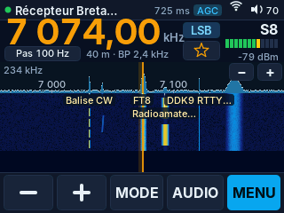 | 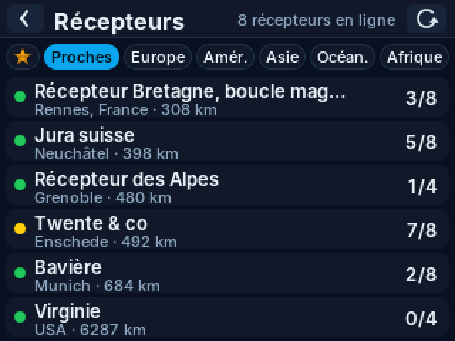 | 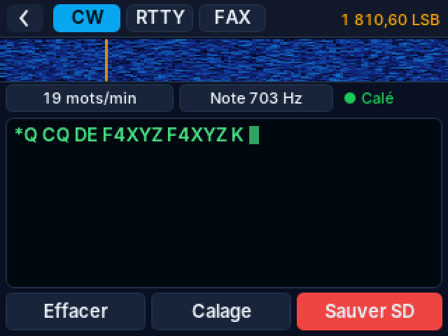 |

Ce projet reprend le matériel, le moteur graphique `gfx`, le pilote tactile et le simulateur PC des projets précédents ([vitesse de la lumière](https://github.com/Edunts5962/Esp32-vitesse-de-la-lumi-re-), [vitesse du son](https://github.com/Edunts5962/Esp32-vitesse-du-son), [moteur gfx](https://github.com/Edunts5962/Esp32-gfx-moteur-graphique)).

---

## Sommaire

1. [Ce que fait la carte](#1-ce-que-fait-la-carte)
2. [Le matériel](#2-le-matériel)
3. [Installation](#3-installation)
4. [Premier démarrage](#4-premier-démarrage)
5. [Les écrans et les gestes](#5-les-écrans-et-les-gestes)
6. [Les décodeurs](#6-les-décodeurs)
7. [Le portail web](#7-le-portail-web)
8. [Comment ça marche](#8-comment-ça-marche)
9. [Simulateur PC](#9-simulateur-pc)
10. [Dépannage](#10-dépannage)
11. [Limites connues et suite](#11-limites-connues-et-suite)
12. [Licence et crédits](#12-licence-et-crédits)

---

## 1. Ce que fait la carte

- **Écoute** de n'importe quel KiwiSDR public en AM, LSB, USB, CW ou FM, avec AGC et largeur de filtre réglables.
- **Waterfall et spectre en couleur** (4 palettes, contraste automatique), zoom de 30 MHz à quelques kHz de large.
- **Accord tactile** : glisser sur le waterfall, toucher un signal pour s'y caler, boutons − / + avec répétition, pavé numérique, 12 raccourcis de bandes.
- **Liste mondiale des récepteurs**, triée par distance depuis ta position, filtrée par région (Europe, Amériques, Asie, Océanie, Afrique), avec le nombre de places libres. Les récepteurs pleins sont signalés et rangés en fin de liste.
- **Récepteurs perso** (le tien, ceux d'un club, avec mot de passe) ajoutés depuis le téléphone.
- **Favoris** : 20 stations (fréquence, mode, filtre, récepteur), rappelées d'un toucher.
- **Décodeurs embarqués** : morse (CW), télex radio (RTTY) et fac-similé météo (FAX), avec sauvegarde sur la carte SD.
- **Enregistrement** du son en WAV sur la carte SD.
- **Portail web** pour configurer le WiFi, la position et les récepteurs perso depuis un téléphone.

## 2. Le matériel

Seulement la carte **ES3C28P**, sans aucun ajout :

| Élément | Rôle | Broches |
|---|---|---|
| Écran ILI9341 2,8" (SPI) | affichage 320 × 240 | MOSI 11, SCLK 12, MISO 13, CS 10, DC 46, rétroéclairage 45 |
| Tactile FT6336 (I2C 0x38) | gestes | SDA 16, SCL 15, RST 18 |
| Codec ES8311 (I2C 0x18) | son | I2S MCLK 4, BCLK 5, WS 7, DOUT 8 |
| Ampli du haut-parleur | marche / arrêt | GPIO 1 (actif à l'état bas par défaut, réglable) |
| Carte microSD (SDIO 4 bits) | enregistrements | CLK 38, CMD 40, D0 39, D1 41, D2 48, D3 47 |

Le bus I2C est partagé entre le tactile et le codec, comme dans les autres projets.

## 3. Installation

### Arduino IDE

1. Paquet **esp32 de Espressif, version 3.x** (testé en compilation avec 3.3.10).
2. Carte **ESP32S3 Dev Module**, avec :
   - PSRAM : **OPI PSRAM** (obligatoire : waterfall, liste et décodeurs vivent en PSRAM) ;
   - Flash Size : **16 MB** ;
   - Partition Scheme : **16M Flash (3MB APP/9.9MB FATFS)**.
3. Bibliothèque : **TFT_eSPI** avec le même `User_Setup.h` que d'habitude (ILI9341, broches ci-dessus, `USE_HSPI_PORT`, 80 MHz). C'est la seule : le client WebSocket est intégré au projet (`ws_client.cpp`), car la bibliothèque WebSockets habituelle refuse les messages de plus de 15 Ko, alors que le KiwiSDR envoie sa configuration (20 à 60 Ko) dès la connexion.
4. Ouvre `firmware/kiwi_console/kiwi_console.ino` et téléverse.

### Sans compiler

Le dossier `binaires/` contient le programme compilé. `kiwi_console.ino.merged.bin` s'écrit en une fois à l'adresse **0x0**, par exemple avec esptool :

```
esptool.py --chip esp32s3 write_flash 0x0 kiwi_console.ino.merged.bin
```

Une fois la v0.13.0 (ou plus récente) installée, les mises à jour suivantes se font sans câble : page web de la carte, onglet **Système**, « Mise à jour du programme », fichier `kiwi_console.ino.bin`.

## 4. Premier démarrage

1. **Étalonnage du tactile** : il est partagé avec tes autres projets. S'il est déjà fait, il n'est pas redemandé.
2. **WiFi** : la première fois, la carte crée son propre réseau WiFi.
   - Sur ton téléphone, connecte-toi au réseau **KiwiSDR-ES3C28P**, mot de passe **kiwisdr123** (affiché aussi à l'écran).
   - Ouvre **http://192.168.4.1** (l'écran l'affiche aussi).
   - Choisis le WiFi de la maison, entre son mot de passe : la carte redémarre et s'y connecte.
3. **Récepteur** : sur l'écran Radio, touche **Récepteurs**. La liste publique se télécharge (quelques secondes), triée du plus proche au plus lointain. Touche une ligne : le son arrive en une à deux secondes.

La carte se souvient du dernier récepteur, de la fréquence, du mode et de tous les réglages : au démarrage suivant, elle reprend l'écoute toute seule.

> Ta position sert seulement à trier la liste. Par défaut c'est Paris ; tu peux la changer dans le portail web.

## 5. Les écrans et les gestes

### Radio

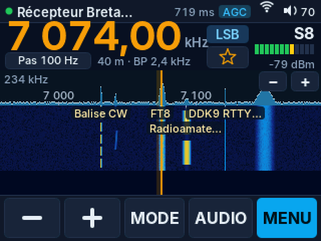

| Zone | Toucher | Appui long / glisser |
|---|---|---|
| Nom du récepteur (en haut) | reconnecte, ou ouvre la liste | – |
| Volume (en haut à droite) | coupe / remet le son | – |
| Grande fréquence | ouvre le pavé numérique | **glisser = réglage fin** (1 pas tous les 10 pixels) |
| **Pas …** (sous la fréquence) | pas suivant : 10 Hz, 100 Hz, 500 Hz, 1, 5, 9, 10 kHz | – |
| **★** (sous le mode) | ajoute la station aux favoris (étoile pleine = déjà favori, toucher pour la retirer) | – |
| **Nom de station** sur le waterfall | se cale sur la station, dans son mode | – |
| Puce du mode (LSB…) | mode suivant : AM, LSB, USB, CW, FM | – |
| Boutons − / + du spectre | zoom du waterfall | – |
| **Waterfall** | **va sur le signal touché** | **glisser = accorder** |
| − / + (en bas) | un pas, dès le contact du doigt | répétition rapide |
| MODE | mode suivant | – |
| **AUDIO** | ouvre / ferme le panneau audio | – |
| MENU | menu | – |

Les boutons de la barre du bas agissent **dès que le doigt touche l'écran**, sans attendre qu'on le relève.

### Panneau AUDIO

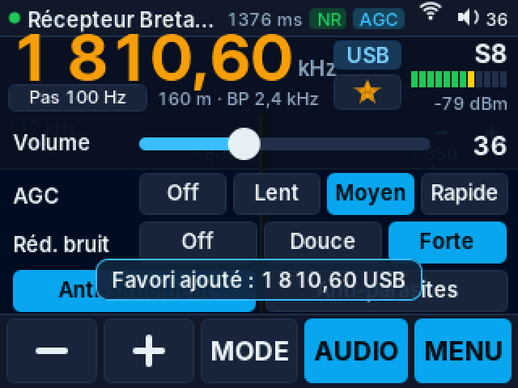

- **Volume** : grand curseur.
- **AGC** du KiwiSDR : Off, Lent, Moyen, Rapide, et dessous son **seuil** (ou le **gain fixe** quand l'AGC est arrêtée).
- **Réduction de bruit** faite par le KiwiSDR : Off, Douce (LMS), Forte (spectrale). Sur un récepteur OpenWebRX, c'est la carte qui la fait (v0.16).
- **Anti-sifflement** (filtre automatique des porteuses) et **Anti-parasites** (crépitements) : Arrêt, Faible, Moyen, Fort.

Ces traitements tournent sur le KiwiSDR, pas sur la carte : ils ne la ralentissent pas. Les témoins NR, NB et AGC en haut de l'écran montrent ce qui est actif. Avec l'anti-sifflement, la réduction « Forte » passe en LMS, car la méthode spectrale ne filtre pas les sifflements. En plus, un **limiteur** sur la carte baisse automatiquement les passages trop forts (désactivable dans Réglages).

En haut à droite, « 350 ms » est la **réserve de son** : ce qui attend d'être joué. Elle absorbe les à-coups d'Internet. Elle passe en orange pendant une remise en réserve. Le S-mètre affiche S1 à S9 puis S9+dB, avec la puissance en dBm (en rouge si l'entrée du KiwiSDR sature).

Le pas se règle tout seul quand on change de mode : 10 Hz en CW, 100 Hz en LSB et USB, 1 kHz en AM, 5 kHz en FM. On peut ensuite le changer avec le bouton **Pas**.

**Noms des stations** : le KiwiSDR envoie le nom des stations de la portion affichée. Par défaut, ce sont celles de la base EiBi **qui émettent à cette heure-ci** ; Réglages › Noms des stations permet de choisir la base de la communauté, la liste du propriétaire du récepteur, ou rien.

Le **trait orange** est la fréquence d'écoute. La **bande orangée** autour est le filtre : elle est à gauche en LSB, à droite en USB, centrée en AM et en FM.

### Menu

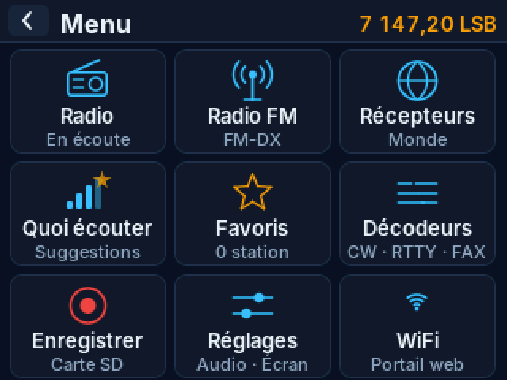

Neuf tuiles : Radio, Radio FM, Récepteurs, **Quoi écouter** (suggestions, mesure, et le clavier de fréquence en haut à droite ; le clavier s'ouvre aussi en touchant la grande fréquence), Favoris (ajout par appui long sur la fréquence), Décodeurs, **Enregistrer** (démarre et arrête l'enregistrement WAV : la tuile clignote et affiche la durée), Réglages, WiFi.

### Récepteurs


- Pastilles : ★ (tes récepteurs perso), Proches (les 40 plus proches), Europe, Amér., Asie, Océan., Afrique.
- Pastille verte : places libres ; jaune : presque plein ; rouge : plein.
- On fait défiler la liste au doigt. La flèche en haut à droite recharge la liste. Elle se recharge aussi toute seule si elle a plus de 15 minutes.
- Appui long sur un récepteur perso : il est retiré.

### Quoi écouter

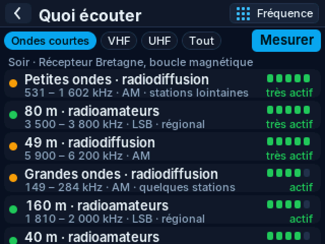 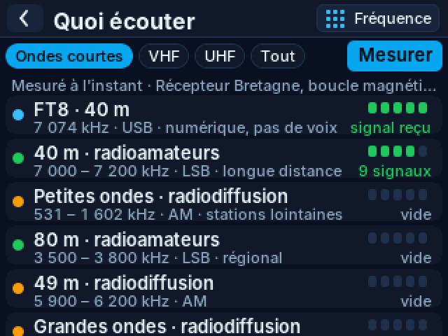

- Quatre catégories : Ondes courtes, VHF, UHF, Tout. À l'ouverture, c'est celle du récepteur écouté.
- Chaque ligne : la bande ou la fréquence, le mode, à quoi s'attendre, et un niveau de 0 à 5 barres. Sans mesure, le niveau est estimé d'après l'heure solaire, la saison et la position du récepteur.
- **Mesurer** compte les signaux réellement présents (voir les notes de la v0.12.0). **Arrêter** garde ce qui est déjà mesuré.
- Toucher une ligne : la radio s'y règle. **Fréquence** (en haut à droite) : saisie au clavier.

### Fréquence

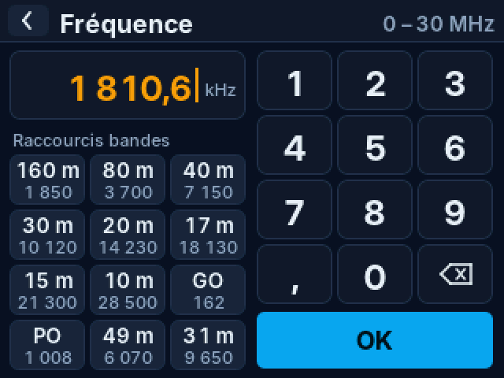

Tape la fréquence en kHz (virgule pour les décimales, 10 Hz près), puis OK. Les 12 raccourcis règlent la fréquence **et** le mode habituel de la bande : LSB sous 10 MHz, USB au-dessus, CW sur 30 m, AM pour la radiodiffusion (GO, PO, 49 m, 31 m). L'appui long sur ⌫ efface tout.

### Réglages

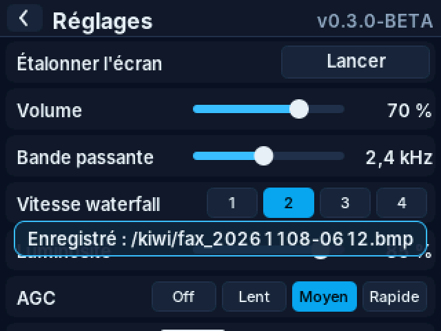

| Réglage | Effet |
|---|---|
| Étalonner l'écran | en tête de liste : toucher **Lancer**, puis **Confirmer ?** dans les 3 secondes |
| Volume | volume du codec ES8311 |
| Bande passante | largeur du filtre du mode en cours (mémorisée par mode) |
| Vitesse waterfall | 1 (lent) à 4 (rapide) |
| Luminosité | rétroéclairage |
| AGC | Off, Lent, Moyen, Rapide |
| Palette | 4 palettes du waterfall et des aperçus |
| Audio compressé | ADPCM : 4 fois moins de données, recommandé en WiFi |
| Réserve audio | 150 à 1 500 ms : plus grand = plus robuste, mais plus de retard |
| Ampli actif bas | à inverser si le haut-parleur reste muet |
| Limiteur de volume | évite les passages trop forts |
| Noms des stations | Non, EiBi (en ondes maintenant), Communauté, Propriétaire |
| Carte SD | espace libre, ou la cause de l'échec ; bouton **Formater** (FAT32) si la carte est illisible |
| Version | numéro de la version installée |

### Favoris et WiFi

| Favoris | WiFi |
|---|---|
| 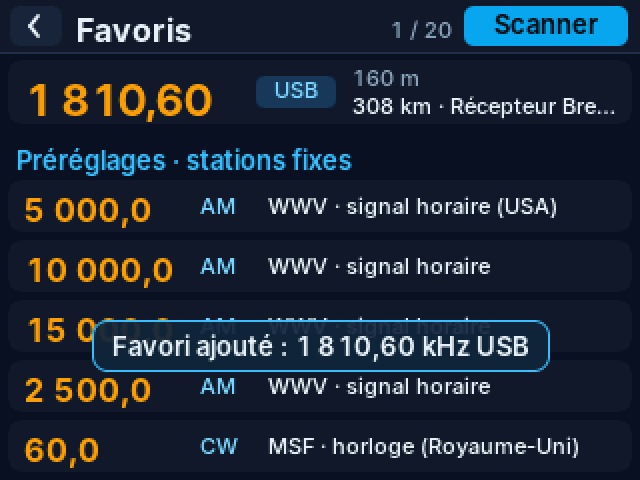 | 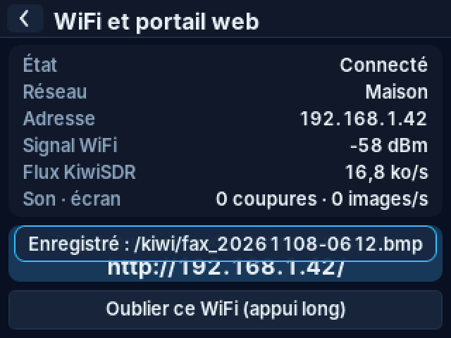 |

Un favori retient aussi son récepteur : le rappeler reconnecte au bon KiwiSDR si besoin. Sous les favoris, des **préréglages** donnent un accès direct aux stations qui ne changent pas de fréquence : signaux horaires WWV (2,5, 5, 10, 15 MHz), DCF77 (77,5 kHz), MSF (60 kHz), météo aviation Shannon Volmet (5 505 kHz), météo marine du DWD (RTTY 10 100,8 kHz, fax 7 880 kHz), FT8 sur 40 et 20 m. L'écran WiFi donne l'adresse du portail, le débit reçu, le nombre de coupures du son et le nombre d'images par seconde de l'écran.

## 6. Les décodeurs

Les décodeurs travaillent sur le son reçu (environ 12 000 échantillons par seconde). En haut, un aperçu du son de 0 à 3 kHz : le trait orange est la tonalité suivie. **Toucher l'aperçu** choisit la tonalité à la main. **Calage** la cherche tout seul. **Sauver SD** écrit le texte ou l'image dans `/kiwi/` sur la carte SD.

| CW | RTTY | FAX |
|---|---|---|
|  | 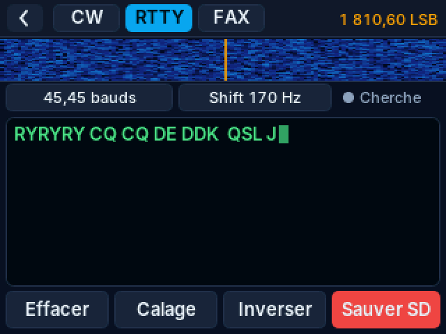 | 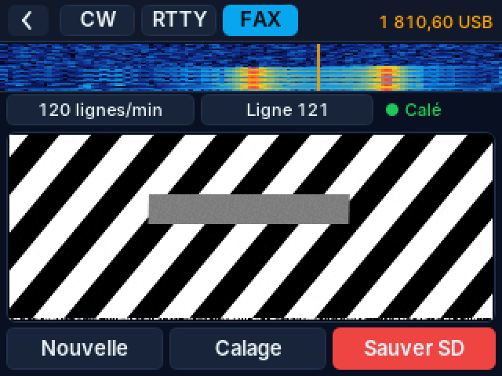 |

- **CW (morse)** : filtre de Goertzel sur la note, seuil qui s'adapte au bruit, vitesse apprise toute seule (affichée en mots par minute). Dans le simulateur, après une ou deux lettres d'accrochage, il lit sans faute de 12 à 35 mots/min, même avec un bruit d'amplitude égale à celle du signal.
- **RTTY** : deux filtres (marque et espace), synchronisation sur le bit de départ, code Baudot avec lettres et chiffres. Toucher la vitesse change de débit (45,45 / 50 / 75 bauds). Toucher le shift le change (170 / 425 / 450 / 850 Hz). **Inverser** échange marque et espace. Les bulletins météo marins en RTTY sont souvent en 50 bauds, shift 450 Hz.
- **FAX** : cartes météo (120 lignes par minute, IOC 576). Accorde en USB **1,9 kHz sous** la fréquence annoncée. Glisser l'image à l'horizontale la recadre. **Nouvelle** repart d'une page blanche. L'image est sauvée en BMP (320 points de large).

- **FT8** : voir plus bas.

Choisir un onglet règle aussi le mode de réception conseillé : CW pour le morse, USB pour le FAX, le FT8 et le RTTY si tu étais en AM ou en FM.

### FT8

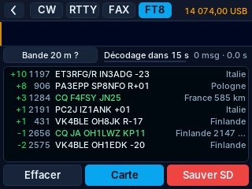 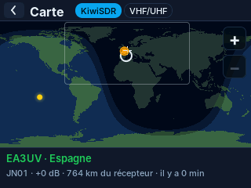

Le FT8 se décode par périodes de 15 secondes calées sur l'heure UTC : la carte prend l'heure sur Internet au démarrage. « Bande › » va sur la fréquence FT8 suivante. La liste montre les messages les plus récents en haut (S/B en dB, fréquence audio, message, pays, distance au récepteur écouté) ; on la fait défiler au doigt. Le décodage ne tourne que lorsque l'écran FT8, la carte FT8 ou l'onglet Décodeurs de la page web est ouvert.

## 6 bis. Les webradios

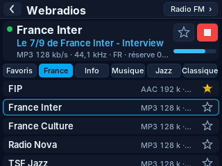

Menu › Radio FM › **Webradios** (ou la tuile « Radio FM » quand une webradio joue). En haut, la station écoutée, le titre du morceau, le format et la réserve ; l'étoile la met en favori, le carré rouge l'arrête, la petite barre règle le volume. Dessous, les choix rapides puis la liste : toucher une ligne la joue, toucher l'étoile la met en favori. La recherche par nom se fait sur la page web, onglet FM (le résultat s'affiche aussi sur l'écran de la carte).

## 7. Le portail web

Depuis un téléphone ou un PC sur le même réseau, ouvre l'adresse affichée dans **Menu › WiFi** (par exemple `http://192.168.1.145/`). C'est **la même radio que sur l'écran de la carte**, et les deux restent synchronisés : ce que tu changes d'un côté apparaît de l'autre. Le son reste sur le haut-parleur de la carte. Le numéro de version est affiché en haut à droite.

| Onglet | Contenu |
|---|---|
| **Radio** | fréquence (clic pour la saisir), mode, pas, − / +, ★, S-mètre, spectre et waterfall en direct (clic = aller sur le signal), zoom, enregistrement, stations à l'écran, volume, AGC, réduction de bruit, anti-sifflement, anti-parasites, limiteur, bande passante, raccourcis de bandes |
| **Récepteurs** | recherche (nom, ville, pays, indicatif), liste par région et par distance, places libres, connexion d'un clic, actualisation, écoute d'une adresse, récepteurs perso (ajouter, retirer, mot de passe) |
| **Quoi écouter** | les mêmes suggestions que sur l'écran (Ondes courtes, VHF, UHF, Tout), bouton Mesurer, un clic pour écouter |
| **FM** | radio FM par Internet (réseau FM-DX) : serveurs du plus proche au plus loin, recherche (ville, pays, nom), écoute d'une adresse ; fréquence, −/+ 0,1 et 1 MHz, saisie directe, RDS (nom et texte), émetteur, signal, stéréo, auditeurs, volume, arrêt |
| **Stations** | annuaire de stations : recherche (nom, pays, langue, fréquence), filtres Anglais / Français / Chinois / Autres / Signaux ; **▶ Ici** règle le récepteur actuel, **📍 Proche** se connecte au récepteur libre le plus proche de l'émetteur (indispensable en ondes moyennes) ; recherche **EiBi** des émissions à l'antenne en ce moment sur le récepteur connecté ; télécharger, recharger ou remettre la liste |
| **Favoris** | rappeler, renommer, supprimer, ajouter la station actuelle, scanner les favoris ; préréglages |
| **Décodeurs** | CW, RTTY, FAX : texte ou image en direct, calage, inversion, vitesse et shift (RTTY), sauvegarde sur la SD |
| **Réglages** | squelch, AM synchrone, reprise automatique, enregistrement à la voix, luminosité, vitesse et palette du waterfall, noms des stations, étalonnage du tactile, réserve audio, audio compressé, ampli, limiteur, carte SD (état, formatage) |
| **Système** | version, WiFi, adresse, signal, flux, coupures du son, images par seconde, mémoire, durée de marche, position, **mise à jour du programme**, WiFi de la maison, adresse de la liste publique, redémarrage |
| **Traduction** (bêta) | bouton qui lance le **KiwiTraducteur** sur le PC, et les phrases traduites en français au fur et à mesure (voir `traducteur/LISEZMOI.md`) |

La page interroge la carte deux fois par seconde. Ses ordres passent par la même file que les touchers de l'écran : la carte les applique à l'image suivante.

## 8. Comment ça marche

### Le protocole KiwiSDR

Le KiwiSDR parle par **deux WebSocket**, ouvertes avec le même numéro :

- `ws://récepteur:8073/<numéro>/SND` : le son et le S-mètre ;
- `ws://récepteur:8073/<numéro>/W/F` : le waterfall.

La carte envoie des commandes texte, par exemple `SET mod=lsb low_cut=-2700 high_cut=-300 freq=7074.000` ou `SET zoom=7 cf=7074.000`. Le KiwiSDR répond par des trames qui commencent par `MSG` (paramètres), `SND` (son) ou `W/F` (une ligne de waterfall de 1 024 points). La séquence suit celle de **kiwiclient**, le client Python officiel du KiwiSDR ([github.com/jks-prv/kiwiclient](https://github.com/jks-prv/kiwiclient)) :

1. `SET auth t=kiwi p=` sur les deux canaux ;
2. le KiwiSDR annonce `audio_rate`, la carte répond `SET AR OK in=12000 out=48000` ;
3. à `sample_rate`, la carte envoie mode, fréquence, AGC, compression ;
4. à `wf_setup`, elle envoie zoom, centre et vitesse du waterfall ;
5. puis un `SET keepalive` toutes les 2 secondes.

`too_busy` (plein), `badp` (mot de passe), `down` (maintenance) et la fin de session sont traduits en messages clairs à l'écran.

### Le son

Le son arrive compressé en **IMA-ADPCM** : 4 bits par échantillon, environ 6 ko/s. Il est décodé puis rangé dans une **réserve** de 5 secondes en PSRAM. La tâche audio le **rééchantillonne de 12 kHz à 48 kHz** pour le codec ES8311. Elle corrige doucement (au plus 1 %) la vitesse de lecture pour garder la réserve à la valeur visée : ainsi, le son ne prend ni retard ni avance, même si l'horloge du KiwiSDR et celle de la carte diffèrent un peu. Un filtre passe-bas à deux pôles adoucit le rééchantillonnage.

### Le waterfall

Chaque ligne de 1 024 points est réduite à 320 colonnes : on garde le maximum de chaque groupe, pour ne perdre aucun signal fin. Le **plancher de bruit** (25e centile de la ligne, lissé dans le temps) fixe automatiquement le contraste sur 60 dB. Quand tu changes de fréquence, le centre du waterfall suit et l'image déjà reçue glisse d'autant de pixels : rien ne se brouille.

### Les tâches

| Cœur | Tâche | Rôle |
|---|---|---|
| 0 | audio (priorité 6) | I2S 48 kHz, jamais bloquée |
| 0 | réseau (priorité 3) | WiFi, 2 WebSocket, portail web |
| 0 | écran (priorité 2) | envoi SPI de l'image précédente |
| 0 | liste (à la demande) | téléchargement de la liste publique, ligne par ligne |
| 1 | loop() | tactile et dessin de l'image suivante (double tampon) |
| 1 | moteur (priorité 1) | décodeurs, écriture sur la carte SD |

### Les fichiers

```
firmware/kiwi_console/
  kiwi_console.ino   matériel : écran, tactile, codec, I2S, WiFi, WebSocket, SD
  kiwi.cpp/.h        protocole KiwiSDR, décodeur ADPCM
  audio.cpp/.h       réserve, fondu anti-clic, réserve adaptative, rééchantillonnage
  nr.cpp/.h          réduction de bruit faite par la carte (son OpenWebRX)
  ft8.cpp/.h         décodeur FT8 (périodes de 15 s, pays, locator) ; src/ft8 : ft8_lib
  webradio.cpp/.h    webradios : annuaire, MP3/AAC, titres ICY, favoris ; src/helix_aac : décodeur AAC
  cascade.cpp/.h     waterfall, palettes, contraste automatique
  serveurs.cpp/.h    liste publique, distances, régions, récepteurs perso
  decodeurs.cpp/.h   CW, RTTY, FAX
  moteur.cpp/.h      tâche de fond, enregistrement WAV
  interface.cpp/.h   écrans et gestes
  carte_monde.h      carte du monde terre / mer (fabriquée par outils/carte/faire_carte.py)
  quoi.cpp/.h        « Quoi écouter » : estimation (heure, saison, position) et comptage des signaux
  portail.cpp/.h     interface web (API JSON + waterfall binaire)
  page_web.h         la page web elle-même (HTML, CSS, JavaScript)
  ws_client.cpp/.h   client WebSocket intégré (messages jusqu'à 512 Ko)
  reglages.cpp/.h    réglages en mémoire flash
  gfx, polices, ft6336_touch   repris des projets précédents
outils/simulateur/sim_main.cpp
traducteur/          KiwiTraducteur (Python, PC) : kiwi_traducteur.py, installer.bat, requirements*.txt
binaires/            programme compilé
images/              captures du simulateur
```

Sur la carte SD : `/kiwi/stations.csv` (la liste de l'onglet Stations, créée au premier démarrage ; une ligne par station : `nom;kHz;mode;langue;pays;latitude;longitude;infos`, modifiable avec un éditeur de texte), `/kiwi/rec_AAAAMMJJ-HHMMSS.wav`, `/kiwi/cw_….txt`, `/kiwi/rtty_….txt`, `/kiwi/fax_….bmp`. L'heure vient d'Internet (fuseau de Paris).

## 9. Simulateur PC

Le simulateur compile **le même code** que la carte (protocole, audio, waterfall, décodeurs, écrans). Il joue le rôle du KiwiSDR : il fabrique de vraies trames `MSG`, `SND` compressées en ADPCM et `W/F`, avec du morse, du RTTY et une image FAX. Puis il rejoue un scénario tactile et enregistre les captures.

```
cd outils/simulateur
g++ -std=c++17 -O2 -I../../firmware/kiwi_console sim_main.cpp \
    ../../firmware/kiwi_console/{gfx,polices,interface,kiwi,fm,fmliste,owrxliste,vhf,geo,quoi,audio,cascade,serveurs,stations,decodeurs,moteur,reglages}.cpp -o sim
./sim captures
```

Il affiche aussi les commandes que la carte enverrait au KiwiSDR, et ce que décodent les décodeurs.

## 10. Dépannage

| Symptôme | Piste |
|---|---|
| Écran blanc ou « Mémoire insuffisante » | PSRAM sur **OPI PSRAM** dans l'IDE |
| Pas de son, waterfall OK | Réglages › **Ampli actif bas** : l'inverser ; vérifier le volume |
| « Récepteur plein » | les KiwiSDR acceptent 4 à 8 personnes : prends-en un autre, ou réessaie plus tard |
| « Mot de passe refusé » | ce KiwiSDR est privé, ou ses places libres sont réservées |
| Son haché, « ms » orange en haut | WiFi faible ou récepteur lointain : augmente la **réserve audio** (600 à 1 000 ms) et garde l'audio compressé |
| Liste vide | vérifie Internet (Menu › WiFi), touche la flèche ; au besoin change l'adresse de la liste dans le portail |
| Le réseau WiFi n'est pas trouvé | au bout de 20 s, la carte repasse en point d'accès **KiwiSDR-ES3C28P** pour qu'on la reconfigure |
| Session coupée au bout d'un moment | beaucoup de KiwiSDR publics limitent la durée d'une session (souvent autour de 30 min) : reconnecte-toi |
| Tactile décalé | Réglages › Étalonner l'écran |

Le moniteur série (115 200 bauds) affiche les étapes : `[KIWI] WebSocket SND ouvert`, adresse du portail, taille de la liste…

## 11. Limites connues et suite

- **Pas encore testé sur la vraie carte, ni sur un vrai KiwiSDR** (seulement compilé, et vérifié dans le simulateur). Le protocole suit kiwiclient à la lettre, mais un premier essai réel est la prochaine étape.
- Le tactile lit un seul doigt : pas de zoom à deux doigts, d'où les boutons − / + du spectre.
- Les KiwiSDR en `https` (port 443) sont acceptés sans vérification du certificat.
- Les décodeurs n'ont été essayés que sur des signaux de synthèse. Le FAX ne détecte pas encore les tonalités de début et de fin d'image.
- Idées pour la suite : carte du monde tactile des récepteurs, commande vocale (« écoute 7 100 kHz en LSB »), décodeur FT8, balayage de bande avec squelch, Alexa via Matter comme sur le détecteur de pub.

## 12. Licence et crédits

- Code : licence MIT (fichier `LICENSE`).
- Police **Inter** de Rasmus Andersson : SIL Open Font License 1.1.
- Protocole : d'après **kiwiclient**, le client Python officiel du KiwiSDR (github.com/jks-prv/kiwiclient).
- Liste publique : **kiwisdr.com/public** et la carte de Pierre Ynard (**rx.linkfanel.net**, projet dyatlov).
- Bibliothèque : TFT_eSPI (Bodmer).
- **ft8_lib** de Kārlis Goba (licence MIT, `firmware/kiwi_console/src/ft8`).
- Décodeur **Helix AAC** de RealNetworks (RPSL/RCSL, `firmware/kiwi_console/src/helix_aac`), **minimp3** de lieff (CC0).
- Annuaire des webradios : **radio-browser.info** (libre, communautaire).

Merci aux propriétaires de KiwiSDR qui partagent leur récepteur. Ils ont peu de places : déconnecte-toi quand tu n'écoutes plus.
