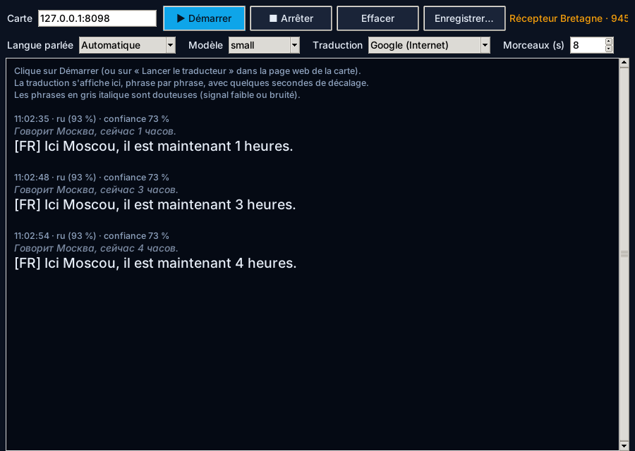

# KiwiTraducteur v0.2.0-BETA — traduction en français de la radio reçue

Programme Python pour PC Windows. Il écoute ce que reçoit la carte ES3C28P, reconnaît la langue parlée avec **Whisper** et affiche la **traduction en français** dans sa fenêtre et dans l'onglet **Traduction** de la page web de la carte.

## Installation (une seule fois)

1. Installe **Python 3.10 à 3.12, 64 bits** depuis python.org, en cochant **« Add python.exe to PATH »**.
2. Double-clique sur **`installer.bat`**. Il installe :
   - les bibliothèques de `requirements.txt` : `faster-whisper`, `numpy`, `requests`, `deep-translator` ;
   - si tu réponds « o » : l'accélération par carte graphique NVIDIA (`requirements-gpu.txt` : `nvidia-cublas-cu12`, `nvidia-cudnn-cu12`) ;
   - si tu réponds « o » : la traduction hors ligne Argos (`requirements-hors-ligne.txt` + `installer_langues_argos.py`) ;
   - le lien `kiwitrad://`, qui permet à la page web de lancer le programme (rien n'est installé au niveau administrateur).
3. Au premier démarrage, Whisper télécharge son modèle depuis Internet : de 75 Mo (`tiny`) à 3 Go (`large-v3`), une seule fois.

Pour tout retirer : `desinstaller.bat`, puis supprime le dossier.

## Utilisation

- Page web de la carte › onglet **Traduction** › **Lancer le traducteur**. La première fois, le navigateur demande d'ouvrir « KiwiTraducteur » : coche « toujours autoriser ».
- Ou à la main : `python kiwi_traducteur.py --carte 192.168.1.145`.
- Le programme lit le son **sur la carte** (déjà nettoyé par le KiwiSDR) : il n'occupe pas de deuxième place sur le récepteur et suit tes changements de fréquence.

| Réglage | Conseil |
|---|---|
| Langue parlée | **Automatique** ; choisis la langue si la détection hésite (signal faible) |
| Modèle | `small` (bon compromis) ; `medium` ou `large-v3` avec une carte NVIDIA ; `base` ou `tiny` sur un PC lent |
| Traduction | **Google (Internet)** : meilleure qualité, gratuite, sans clé ; **Argos** : hors ligne, passe par l'anglais |
| Mode | **Continu** (par défaut) : analyse toutes les secondes, mots provisoires en gris en bas, phrase traduite 2 à 4 s après sa fin ; **Par morceaux** : l'ancien fonctionnement, plus précis mais 8 à 10 s de décalage |
| Morceaux | Mode Par morceaux seulement. 8 s : le texte arrive toutes les 6 à 10 s ; plus court = plus réactif mais moins précis |
| Texte original | affiche aussi la phrase dans sa langue d'origine |

### Mode Continu et vitesse du PC

Le mode Continu réanalyse le son en permanence et demande plus au processeur.
En bas, « Continu · analyse en X s » doit rester sous 1,5 s environ. Au-dessus, le texte prend du retard :
choisis le modèle **base** (ou **tiny**). Le programme utilise tous les cœurs du processeur sauf un.

### Argos : n'installer que certaines langues

- `python installer_argos_anglais.py` : anglais → français seulement (environ 100 Mo) ;
- `python installer_argos_chinois.py` : chinois → anglais → français.

Prérequis : `python -m pip install argostranslate`.

## Limites (bêta)

- **Décalage** de quelques secondes : il faut entendre une phrase entière.
- **Bruit** : une station de radiodiffusion forte et propre donne de bons résultats ; un signal faible, du fading ou une BLU mal calée donnent une traduction approximative. Les phrases douteuses s'affichent en **gris italique** (confiance faible).
- Une détection de voix ignore le bruit et la musique, et les phrases que Whisper invente sur du silence (« Merci d'avoir regardé »…) sont filtrées.
- Testé sur PC avec une fausse carte et un faux modèle (enchaînement, fenêtre, filtrage, envoi à la carte, lien `kiwitrad://`). La reconnaissance réelle reste à essayer chez toi : mon environnement ne peut pas télécharger les modèles Whisper.

## Diagnostic

- `python kiwi_traducteur.py --test-son --carte 192.168.1.145` affiche pendant 10 s le niveau du son reçu de la carte.
- « Carte injoignable » : vérifie l'adresse (écran de la carte › Menu › WiFi) et que le PC est sur le même réseau.
- La carte graphique n'est pas utilisée : relance `installer.bat` et réponds « o » à la question NVIDIA. Le programme repasse tout seul sur le processeur en cas de problème.
